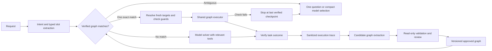

# Rove action graphs

## Product contract

Rove should solve an unfamiliar request once, then reuse a verified procedure when the same intent returns. A remembered procedure is a small executable graph with typed slots, fresh target discovery, checks, and recovery edges. It is not a recording of mouse coordinates or a transcript sent back to the model.

The execution engine remains the authority for permissions, cancellation, verification, and duplicate-action protection. Graph execution and model execution use the same tools and policies. Learning must never turn “the launcher started” into “the remote task succeeded.”

## What ships in this iteration

- Windows installer configuration, persistent user data, tray recovery, and renderer recovery. Installation on this machine remains blocked by Smart App Control rejecting the unsigned packaged executable; a trusted signed release is required under the current policy.
- A conservative local route for simple `close <app>` requests. It discovers current targets, asks if ambiguous, closes gracefully, and verifies the result without a model.
- Existing explicit URL/file launches and named routines also execute locally.
- Desktop helper reuse avoids a PowerShell process and compilation for each step. Native mouse observation is optional; a blocked native addon cannot prevent startup.
- Local execution traces include elapsed time and zero-model-call evidence. Task history is cached between actual changes rather than reread during every companion animation.

These are hand-authored execution paths, not learned graphs. No autonomous learning or inferred performance savings is being claimed yet.

## End-to-end path

## Graph representation

Use SQLite, not an additional graph service. Graph topology is small and local. Store immutable versions with JSON input schemas, predicates, and slot bindings; index intent aliases and target identities for retrieval.

| Record | Required contents |
| --- | --- |
| `graphs` | Stable ID, human name, intent frame, aliases, current approved version, enabled state |
| `graph_versions` | Version, originating run IDs, tool-schema versions, slot schema, guards, expected outcome, review status |
| `graph_nodes` | Node ID, tool/action, arguments bound to slots or prior verified outputs, precondition, output check, timeout, retry class |
| `graph_edges` | From/to IDs, success/failure/question branch, dependency condition |
| `graph_runs` | Matched graph/version, resolved slots, matching reason, outcome, model calls, token usage, duration, failed node |
| `graph_evidence` | Run-scoped references to redacted observations and checks; retention policy |

Node kinds are `observe`, `act`, `check`, `ask`, and `finish`. Independent nodes may run in parallel only when they do not share mutable state. Browser navigation and its dependent click remain ordered. Every act node uses the existing validated tool registry.

### Example: close an app

Intent frame `close_application(app_identity, optional_window_title)`:

1. Discover windows using product name, executable identity, and optional exact title.
2. Check one target is selected. If several match, ask which window; do not choose by enumeration order.
3. Bind the current window ID and owning PID from that observation.
4. Dispatch graceful close once.
5. Check window closure. If a save prompt appears, pause or return to the solver with that evidence.
6. Finish with an accurately scoped result. A tray/background process remaining alive is a separate fact.

The saved graph contains an app identity and selection rules, never a historical HWND or PID. The existing local close route is a seed implementation of this procedure and should move onto the shared graph executor later.

### Example: prepare a web form

Slots include origin, form purpose, and nonsensitive user-provided values. Guards include the browser profile/account scope, allowed origin, current page identity, and required field availability. Resolve accessibility locators afresh. Check each dependent action. A graph that prepares a draft has no authority to submit, pay, send, or delete. A changed page or login requirement pauses execution rather than replaying guessed clicks.

## Learning and promotion

1. Record a complete typed trace alongside a compact model context. Instrument the shared executor while inputs are available in memory; current redacted historical logs cannot reliably reconstruct executable arguments.
2. Extract candidates only from completed runs with sufficient outcome verification. Treat page/document content as data, not training instructions.
3. Replace incidental values with typed slots. Keep meaningful constants such as a verified site origin. Separate app discovery from current runtime IDs.
4. Deduplicate by intent frame plus guarded target/action structure, not string similarity alone. Similar requests with different accounts or final effects are different variants.
5. Validate proposed graphs without replaying mutations. A shadow run can check targets and preconditions; it must not silently send, launch, close, or submit anything a second time.
6. Initially require explicit user review to enable a candidate. Repeated successful runs may suggest a routine, but three examples alone do not establish a reliable success rate.
7. Consider automatic promotion only for low-impact, reversible procedures after a representative evaluation set and calibrated matching policy exist. High-impact actions retain current-request authorization every time.
8. Version changes. Quarantine a graph after a failed guard or unexplained result; repair creates a new version and cannot erase the failure history.

## Matching without wasting tokens

Start with deterministic intent frames, explicit aliases, app/site identity, and schema validation. Use SQLite FTS for candidate retrieval. Do not add a model call merely to identify an already exact local match.

If wording is ambiguous, show up to three concise candidate summaries to a small model selection request or ask the user. Do not resend all traces or tool definitions. Optional local embeddings can improve retrieval later, after measuring accuracy and memory cost. Raw embedding similarity is not permission to execute a graph.

A valid replay sends no tokens to the model. A guard failure sends only the goal, constraints, last verified checkpoint, failed predicate, and compact current evidence. Larger snapshots remain local and are read by reference as needed.

## Recovery rules

- Resolve targets again on every execution. Never reuse window IDs, process IDs, DOM handles, screen coordinates, or a previous login assertion.
- Stop the batch on the first failed dependent check. Never continue through a missing target.
- Retry reads when useful and bounded. Retry mutations only if the declared retry contract and observed state establish that the action did not happen.
- Never blindly replay URL launches, SSH launches, sends, payments, or closes after an ambiguous timeout.
- The solver receives only the unfinished suffix. It must not repeat successful launch nodes as a recovery tactic.
- Manual-login and clarification branches preserve the current goal and completed steps. Cancel prevents remaining nodes and preserves evidence of dispatched work.
- Display “Using your routine” only after an actual approved graph was selected and its entry guards passed.

## Privacy and boundaries

Graphs stay local by default. Do not learn passwords, API keys, tokens, cookies, sensitive form values, or authentication prompts. Parameterize user-specific values and obtain them from current authorized configuration, not copied snapshots. An approved graph does not carry reusable approval tokens. Re-evaluate the current task's stop-at-review and final-action boundaries on every run.

Keep account/profile scopes opaque and local. Changing account or site origin invalidates relevant guards. Tool-schema migrations invalidate incompatible nodes. Deleting a graph removes its reusable bindings; deleting a trace follows a documented retention policy without silently breaking unrelated versions.

## Build order and acceptance gates

| Stage | Deliverable | Gate before moving on |
| --- | --- | --- |
| 1. Baselines | Shared executor events, provider usage counters, model wait time vs tool time, sanitized candidate inputs | Can explain where latency and tokens went for each run; credentials never enter the trace |
| 2. Graph executor | Typed DAG/branch interpreter, bindings, guards, checkpoints, cancellation, graph-version storage | Existing local routines execute with equal verification; failure stops dependent nodes; no duplicate launch in recovery tests |
| 3. Candidate review | Suggestions from successful traces, inspectable steps/slots, edit/approve/disable UI | User can understand the remembered behavior; failed or weakly verified runs cannot auto-promote |
| 4. Matching and replay | Exact-frame lookup, FTS candidate retrieval, guarded zero-model replay | Ambiguous and wrong-account requests do not auto-execute; replay performs fresh target discovery |
| 5. Repair and expansion | Compact solver handoff, immutable repaired versions, optional local semantic retrieval | No repeated completed mutations; measured reliability improves rather than merely reducing model calls |

Keep the first pilot to app window operations, local resources, and read-only browser tasks. Expand to form editing only after origin/account/field checks and final-action boundaries are tested. Do not begin with arbitrary recorded PowerShell scripts or coordinate macros.

## Measurement

Measure time to first useful action, total wall time, model wait, tool execution, input/output/cached tokens, model calls, clarification rate, guard failures, and verified task success. Count zero-model local runs explicitly. Compare the same request, target state, and user account; do not compare a cached page with a cold login and call the difference a learning gain.

Initial performance targets, not promises: warm local commands should begin within 150 ms and ordinarily finish within one second, excluding application save prompts and app shutdown time. For learned browser routines, target at least 50% fewer model calls/tokens than the first successful solve while maintaining verified outcomes. Site response time is still real latency.

Create a benchmark set spanning app/window ambiguity, files, URLs, browser reading, form drafts, multiple accounts, missing configuration, changed pages, partial failures, and cancellation. Hold out phrasing and target-state variants. Report both correct matches and false matches. Reject a release that is faster only because it skips verification or guesses targets.

## First next implementation

Build Stage 1 and the minimal Stage 2 interpreter. Port `close_application` and existing manually configured launch routines onto it. Capture a candidate from an actual successful read-only browser task, review it, and show a second execution taking the guarded graph path with fewer model calls. That is the smallest convincing demonstration of learning; a static diagram or a cache of final answers is not.
